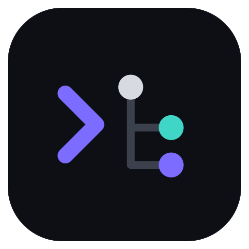
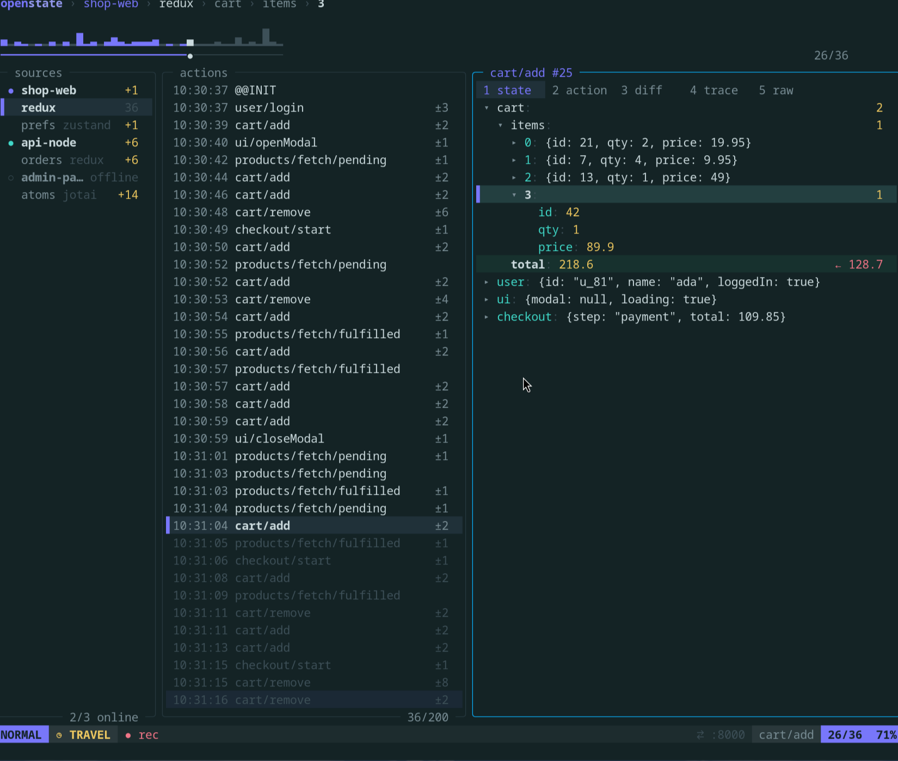

<div align="center">



# openstate

**Redux DevTools, in your terminal.**



</div>

## Install

```sh
npm i -g @openstate/cli
```

or

```sh
curl -fsSL https://raw.githubusercontent.com/franlol/openstate/main/install.sh | sh
```

Then run `openstate`. It is a single binary: no Bun or Node needed to run it.
The script also adds it to your app launcher; with npm, `openstate --desktop` does.

## Connect your app

Your app needs just one of these, depending on where it runs:

| Your app | Do this |
| --- | --- |
| Already uses Redux DevTools remote | Nothing, it connects on its own |
| Runs in the browser | Add `import "@openstate/client"` as its first import |
| Runs in Node or Bun | Start it with `node --import @openstate/client app.js`<br>or `bun --preload @openstate/client app.ts` |

The last two need the client in the project: `npm i -D @openstate/client`

## What you get

- Redux, zustand, jotai and anything built on the devtools API
- Time travel: skip, reorder, revert and dispatch actions
- The diff of every change and the stack trace of every action
- Several apps on one timeline
- Vim keys, mouse and themes

Press `?` inside openstate for every key.

<br>

[Full guide](docs/guide.md) · [MIT](LICENSE)
